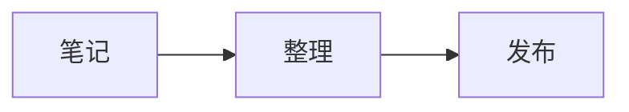

# 常用语法速查

Material for MkDocs 在标准 Markdown 之上加了不少排版组件，下面这些是日常最常用的。

## 提示块 Admonition

```markdown
!!! note "标题可省略"
    正文需要缩进 4 个空格。
```

!!! note "标题可省略"
    正文需要缩进 4 个空格。

可选的类型：`note` `tip` `warning` `danger` `info` `success` `question` `quote` `example` `abstract` `bug` `failure`。

把 `!!!` 换成 `???` 就变成默认折叠，换成 `???+` 是默认展开：

???+ tip "点一下折叠"
    折叠块里的内容。

```markdown
???+ tip "点一下折叠"
    折叠块里的内容。
```

## 标签页 Tabbed

````markdown
=== "Python"

    ```python
    print("hello")
    ```

=== "JavaScript"

    ```js
    console.log("hello");
    ```
````

=== "Python"

    ```python
    print("hello")
    ```

=== "JavaScript"

    ```js
    console.log("hello");
    ```

## 代码块

带文件名标题和高亮行：

````markdown
```python title="demo.py" hl_lines="2"
def greet(name):
    return f"Hello, {name}"
```
````

```python title="demo.py" hl_lines="2"
def greet(name):
    return f"Hello, {name}"
```

行内代码里写反引号用双反引号包裹：`` `code` ``。

## 表格与列表

```markdown
| 左对齐 | 居中 | 右对齐 |
| :--- | :---: | ---: |
| a | b | c |
```

| 左对齐 | 居中 | 右对齐 |
| :--- | :---: | ---: |
| a | b | c |

任务列表：

- [x] 已完成
- [ ] 待办

## 图标与 Emoji

```markdown
:material-language-python:  :smile:  :fontawesome-brands-github:
```

:material-language-python: :smile: :fontawesome-brands-github:

图标名可以在 [Material 图标库](https://squidfunk.github.io/mkdocs-material/reference/icons-emojis/) 搜索。

## 内容卡片 Grid

```markdown
<div class="grid cards" markdown>

-   :material-book: **卡片标题**
    卡片描述。

</div>
```

## 数学公式

行内 $E = mc^2$，独立公式：

$$
\int_a^b f(x)\,\mathrm{d}x = F(b) - F(a)
$$

```markdown
行内 $E = mc^2$

$$
\int_a^b f(x)\,\mathrm{d}x
$$
```

## Mermaid 图表

````markdown

````


## 图片

```markdown
{ width="400" loading=lazy }
```

`{ width="400" }` 这类写法来自 `attr_list` 扩展，可以控制尺寸、对齐、懒加载。

## 脚注与按键

脚注[^1]，按键 ++ctrl+alt+delete++。

[^1]: 这是脚注内容，写在页面任意位置即可。
